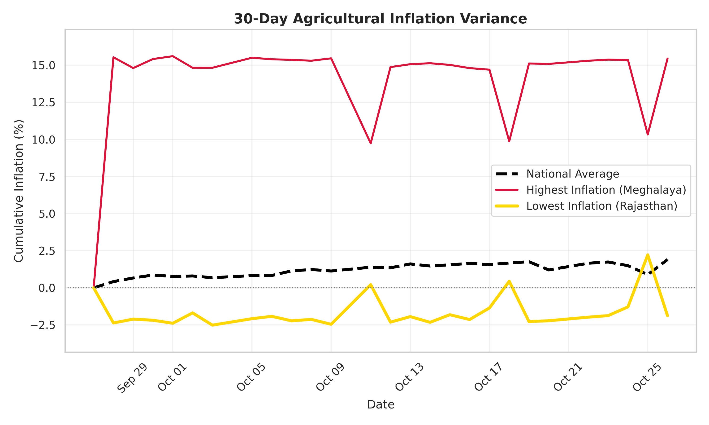
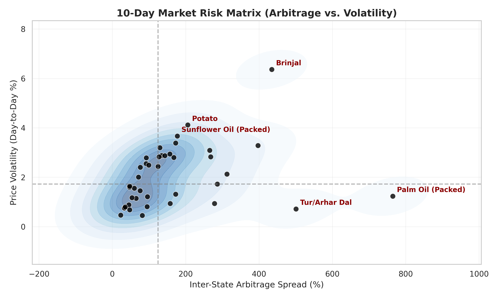

#  Agri-Price daily smart Dashboard
> **Status:** Operational | **Data Snapshot:** October 16, 2026

This automated engine tracks wholesale prices across India and uses Machine Learning to forecast short-term price momentum.

> **National Average Inflation:** 30-Day: +1.75% | 7-Day: +0.44% | 24-Hour: +0.13%

##  Price Momentum & Forecasts
| S.No | Commodity | 1-Month Trend | 1-Week Trend | Price Difference | Tomorrow (Forecast) |
|---|---|---|---|---|---|
| 1 | **Atta (Wheat)** | +1.46% | +0.27% | ₹34.05 | -₹0.19 |
| 2 | **Bajra (whole)** | +2.81% | +4.03% | ₹102.33 | +₹0.74 |
| 3 | **Banana** | -0.33% | +0.60% | ₹55.81 | +₹0.09 |
| 4 | **Besan** | +1.44% | +0.47% | ₹57.33 | +₹0.25 |
| 5 | **Black Pepper (whole)** | -0.25% | +0.02% | ₹23.58 | -₹0.29 |
| 6 | **Brinjal** | -1.18% | -0.33% | ₹129.06 | -₹0.27 |
| 7 | **Broken Rice** | -0.16% | +0.14% | ₹45.47 | -₹0.09 |
| 8 | **Butter (Pasteurised)** | +0.28% | +0.15% | ₹12.82 | +₹0.06 |
| 9 | **Coriander (whole)** | +3.93% | +2.55% | ₹51.41 | +₹0.34 |
| 10 | **Cummin Seed (whole)** | -0.76% | -0.07% | ₹47.36 | -₹0.10 |
| 11 | **Desi Ghee** | +3.53% | +0.34% | ₹255.64 | -₹0.07 |
| 12 | **Eggs** | +0.02% | -0.47% | ₹44.00 | +₹0.18 |
| 13 | **Garlic** | +1.27% | +0.49% | ₹60.05 | -₹0.23 |
| 14 | **Ginger** | -2.28% | +0.29% | ₹68.00 | -₹0.26 |
| 15 | **Gram Dal** | +3.25% | +1.60% | ₹50.12 | +₹0.14 |
| 16 | **Groundnut Oil (Packed)** | +2.30% | -0.46% | ₹226.00 | +₹0.95 |
| 17 | **Gur** | -1.23% | -0.51% | ₹59.29 | +₹0.11 |
| 18 | **Jowar (whole)** | -0.26% | +0.14% | ₹35.00 | -₹0.02 |
| 19 | **Maida (wheat)** | -0.52% | -0.32% | ₹35.33 | -₹0.20 |
| 20 | **Masoor Dal** | +0.39% | +0.37% | ₹50.07 | -₹0.03 |
| 21 | **Milk @** | +0.75% | -0.17% | ₹36.56 | +₹0.03 |
| 22 | **Moong Dal** | +1.14% | +0.68% | ₹29.32 | +₹0.07 |
| 23 | **Mustard Oil (Packed)** | +4.05% | +2.86% | ₹83.26 | -₹0.36 |
| 24 | **Onion** | -0.07% | -0.84% | ₹49.93 | -₹0.20 |
| 25 | **Palm Oil (Packed)** | +3.62% | +0.73% | ₹178.00 | +₹0.45 |
| 26 | **Potato** | -2.52% | -1.50% | ₹36.36 | -₹0.09 |
| 27 | **Ragi (whole)** | +1.94% | +0.27% | ₹72.33 | +₹0.39 |
| 28 | **Red Chillies (whole)** | +2.51% | +1.95% | ₹31.12 | +₹0.18 |
| 29 | **Rice** | +1.08% | -0.01% | ₹32.41 | +₹0.03 |
| 30 | **Salt Pack (Iodised)** | -0.47% | +0.26% | ₹20.07 | +₹0.03 |
| 31 | **Soya Oil (Packed)** | +2.84% | -0.06% | ₹164.17 | +₹0.88 |
| 32 | **Sugar** | -1.15% | +4.20% | ₹21.91 | +₹0.12 |
| 33 | **Suji (whole)** | +0.08% | +0.36% | ₹52.17 | +₹0.00 |
| 34 | **Sunflower Oil (Packed)** | +0.68% | +0.44% | ₹466.00 | -₹0.62 |
| 35 | **Tea Loose** | +0.52% | +0.22% | ₹424.82 | -₹2.57 |
| 36 | **Tomato** | +3.72% | -2.49% | ₹66.56 | +₹0.03 |
| 37 | **Tur/Arhar Dal** | +3.99% | +2.00% | ₹131.50 | +₹0.76 |
| 38 | **Turmeric (powder)** | -0.40% | -0.57% | ₹10.68 | -₹0.02 |
| 39 | **Urad Dal** | +2.27% | +0.88% | ₹45.30 | -₹0.24 |
| 40 | **Vanaspati (Packed)** | +1.87% | +0.25% | ₹74.88 | -₹0.25 |
| 41 | **Wheat** | +0.08% | -0.00% | ₹20.33 | -₹0.14 |

##  Visual Trends

### 30-Day Inflation Variance (National vs Extremes)
*The graph below represents the average cumulative inflation across India, compared against the specific State or Union Territory experiencing the highest and lowest price variations over the last 30 days.*

### 10-Day Market Risk Matrix (Arbitrage vs. Volatility)
**How to read this matrix:**

* **Bottom-Right Quadrant (Golden Zone):** High profit margins, stable prices.
* **Top-Right Quadrant (High Risk):** Huge profit margins, but prices change violently.
* **Top-Left Quadrant (Chaos Zone):** Low profit margins and highly unstable prices.
* **Bottom-Left Quadrant (Safe Zone):** Low profit margins, but very predictable staple prices.

<b>  Click to View: Daily State-by-State Highs & Lows</b>

| S.No | Commodity | Highest Price | Lowest Price | Today (Predicted) | Average |
|---|---|---|---|---|---|
| 1 | **Atta (Wheat)** | ₹68.00 (Andaman an) | ₹33.95 (Uttar Prad) | **₹42.67** | ₹43.06 |
| 2 | **Bajra (whole)** | ₹128.00 (Manipur) | ₹25.67 (Haryana) | **₹49.10** | ₹48.46 |
| 3 | **Banana** | ₹93.00 (Ladakh) | ₹37.19 (Madhya Pra) | **₹55.97** | ₹56.04 |
| 4 | **Besan** | ₹141.00 (Andaman an) | ₹83.67 (Manipur) | **₹101.21** | ₹101.10 |
| 5 | **Black Pepper (whole)** | ₹104.67 (DNH and DD) | ₹81.09 (Gujarat) | **₹90.73** | ₹91.18 |
| 6 | **Brinjal** | ₹161.00 (Andaman an) | ₹31.94 (Madhya Pra) | **₹50.03** | ₹50.60 |
| 7 | **Broken Rice** | ₹70.00 (Andaman an) | ₹24.53 (Jharkhand) | **₹39.93** | ₹40.27 |
| 8 | **Butter (Pasteurised)** | ₹70.00 (Andaman an) | ₹57.18 (Gujarat) | **₹61.26** | ₹61.19 |
| 9 | **Coriander (whole)** | ₹85.50 (Mizoram) | ₹34.09 (Gujarat) | **₹49.53** | ₹49.05 |
| 10 | **Cummin Seed (whole)** | ₹80.00 (Mizoram) | ₹32.64 (West Benga) | **₹42.94** | ₹42.93 |
| 11 | **Desi Ghee** | ₹877.00 (Goa) | ₹621.36 (Telangana) | **₹715.05** | ₹716.22 |
| 12 | **Eggs** | ₹114.00 (Andaman an) | ₹70.00 (Puducherry) | **₹85.77** | ₹85.36 |
| 13 | **Garlic** | ₹93.33 (Andaman an) | ₹33.28 (Bihar) | **₹48.73** | ₹49.07 |
| 14 | **Ginger** | ₹93.00 (Andaman an) | ₹25.00 (Sikkim) | **₹36.76** | ₹37.14 |
| 15 | **Gram Dal** | ₹135.00 (Ladakh) | ₹84.88 (Chhattisga) | **₹95.56** | ₹95.85 |
| 16 | **Groundnut Oil (Packed)** | ₹289.00 (Andaman an) | ₹63.00 (Jammu and ) | **₹198.55** | ₹196.85 |
| 17 | **Gur** | ₹118.67 (Mizoram) | ₹59.38 (Chhattisga) | **₹70.51** | ₹70.34 |
| 18 | **Jowar (whole)** | ₹65.00 (Ladakh) | ₹30.00 (Arunachal ) | **₹47.87** | ₹48.12 |
| 19 | **Maida (wheat)** | ₹71.33 (Andaman an) | ₹36.00 (Bihar) | **₹44.76** | ₹45.10 |
| 20 | **Masoor Dal** | ₹130.20 (Tripura) | ₹80.13 (Odisha) | **₹94.45** | ₹94.54 |
| 21 | **Milk @** | ₹81.56 (Mizoram) | ₹45.00 (Tamil Nadu) | **₹64.84** | ₹64.70 |
| 22 | **Moong Dal** | ₹135.14 (Manipur) | ₹105.82 (Gujarat) | **₹117.31** | ₹117.38 |
| 23 | **Mustard Oil (Packed)** | ₹250.33 (Andaman an) | ₹167.07 (Nagaland) | **₹212.45** | ₹213.01 |
| 24 | **Onion** | ₹95.67 (Andaman an) | ₹45.74 (Madhya Pra) | **₹57.20** | ₹57.36 |
| 25 | **Palm Oil (Packed)** | ₹199.67 (Andaman an) | ₹21.67 (Arunachal ) | **₹143.19** | ₹142.63 |
| 26 | **Potato** | ₹50.00 (Andaman an) | ₹13.64 (West Benga) | **₹25.25** | ₹25.46 |
| 27 | **Ragi (whole)** | ₹100.00 (Mizoram) | ₹27.67 (Manipur) | **₹57.37** | ₹56.69 |
| 28 | **Red Chillies (whole)** | ₹55.00 (Goa) | ₹23.88 (Andhra Pra) | **₹33.20** | ₹32.98 |
| 29 | **Rice** | ₹68.84 (Karnataka) | ₹36.43 (Meghalaya) | **₹48.01** | ₹48.05 |
| 30 | **Salt Pack (Iodised)** | ₹31.67 (DNH and DD) | ₹11.60 (Tripura) | **₹23.87** | ₹23.84 |
| 31 | **Soya Oil (Packed)** | ₹220.00 (Ladakh) | ₹55.83 (Tamil Nadu) | **₹162.89** | ₹160.62 |
| 32 | **Sugar** | ₹75.00 (Ladakh) | ₹53.09 (Telangana) | **₹59.27** | ₹59.83 |
| 33 | **Suji (whole)** | ₹90.00 (Andaman an) | ₹37.83 (Himachal P) | **₹51.90** | ₹52.11 |
| 34 | **Sunflower Oil (Packed)** | ₹645.00 (Ladakh) | ₹179.00 (Jammu and ) | **₹206.95** | ₹208.31 |
| 35 | **Tea Loose** | ₹645.00 (Ladakh) | ₹220.18 (Gujarat) | **₹297.24** | ₹302.71 |
| 36 | **Tomato** | ₹92.56 (Mizoram) | ₹26.00 (Puducherry) | **₹46.89** | ₹46.56 |
| 37 | **Tur/Arhar Dal** | ₹153.00 (Delhi) | ₹21.50 (Sikkim) | **₹131.62** | ₹131.33 |
| 38 | **Turmeric (powder)** | ₹25.00 (Mizoram) | ₹14.32 (Odisha) | **₹17.38** | ₹17.37 |
| 39 | **Urad Dal** | ₹152.00 (Sikkim) | ₹106.70 (Assam) | **₹130.07** | ₹130.84 |
| 40 | **Vanaspati (Packed)** | ₹224.67 (Andaman an) | ₹149.79 (Andhra Pra) | **₹178.71** | ₹179.32 |
| 41 | **Wheat** | ₹48.50 (Manipur) | ₹28.17 (Uttar Prad) | **₹37.69** | ₹37.97 |

---
*Generated automatically by AgriPulse Engine on GitHub Actions.*
