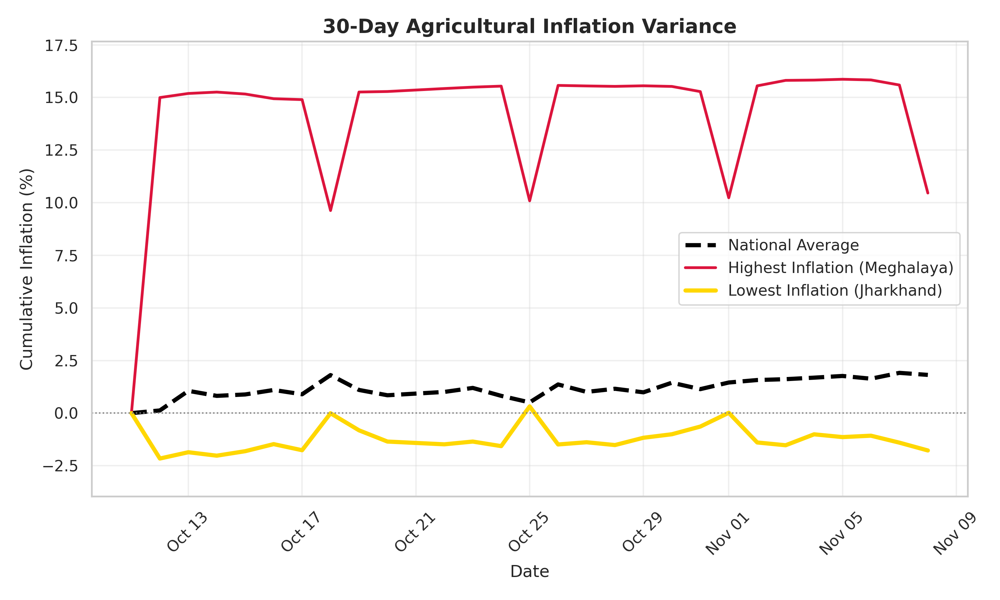
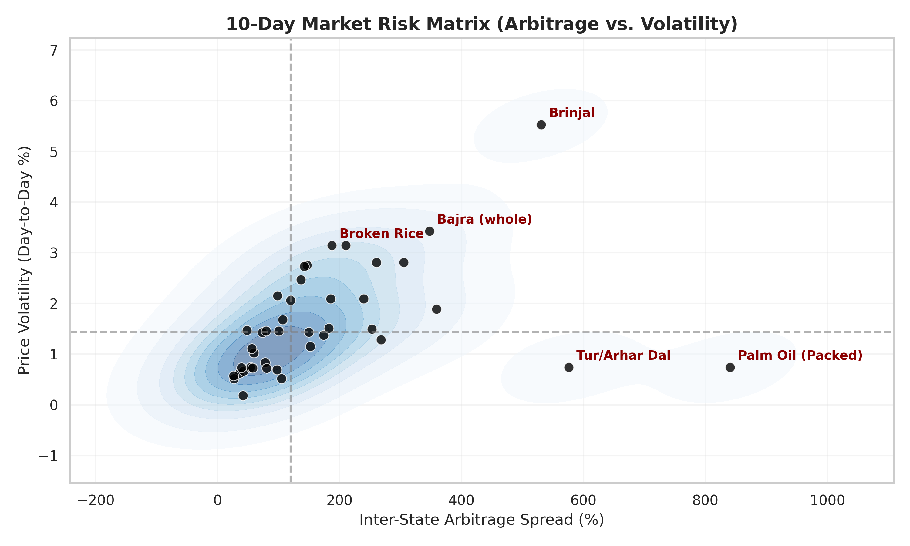

#  Agri-Price daily smart Dashboard
> **Status:** Operational | **Data Snapshot:** November 13, 2026

This automated engine tracks wholesale prices across India and uses Machine Learning to forecast short-term price momentum.

> **National Average Inflation:** 30-Day: +1.07% | 7-Day: +0.38% | 24-Hour: +0.20%

##  Price Momentum & Forecasts
| S.No | Commodity | 1-Month Trend | 1-Week Trend | Price Difference | Tomorrow (Forecast) |
|---|---|---|---|---|---|
| 1 | **Atta (Wheat)** | +1.87% | +1.85% | ₹34.13 | -₹0.28 |
| 2 | **Bajra (whole)** | +4.64% | -0.26% | ₹102.33 | -₹0.29 |
| 3 | **Banana** | -0.20% | +0.15% | ₹56.19 | -₹0.62 |
| 4 | **Besan** | +1.42% | +0.62% | ₹61.80 | -₹0.22 |
| 5 | **Black Pepper (whole)** | +0.90% | +0.19% | ₹26.55 | -₹0.04 |
| 6 | **Brinjal** | -1.85% | -0.29% | ₹144.67 | -₹0.80 |
| 7 | **Broken Rice** | +0.26% | +0.42% | ₹45.65 | -₹0.11 |
| 8 | **Butter (Pasteurised)** | +1.18% | +0.70% | ₹13.06 | -₹0.02 |
| 9 | **Coriander (whole)** | +0.01% | -0.53% | ₹55.18 | +₹0.32 |
| 10 | **Cummin Seed (whole)** | +0.56% | -0.35% | ₹44.44 | -₹0.31 |
| 11 | **Desi Ghee** | +2.04% | +1.61% | ₹443.86 | -₹1.69 |
| 12 | **Eggs** | +1.50% | +0.07% | ₹45.00 | +₹0.53 |
| 13 | **Garlic** | +0.41% | -0.19% | ₹61.07 | -₹0.12 |
| 14 | **Ginger** | -5.49% | -1.17% | ₹72.00 | -₹0.13 |
| 15 | **Gram Dal** | +3.53% | +1.23% | ₹47.37 | -₹0.08 |
| 16 | **Groundnut Oil (Packed)** | +2.07% | +0.07% | ₹240.00 | +₹0.03 |
| 17 | **Gur** | +0.94% | +0.27% | ₹56.49 | +₹0.24 |
| 18 | **Jowar (whole)** | +2.01% | +0.60% | ₹47.00 | -₹0.17 |
| 19 | **Maida (wheat)** | +1.00% | +0.30% | ₹37.18 | -₹0.17 |
| 20 | **Masoor Dal** | -0.37% | -0.38% | ₹44.94 | -₹0.29 |
| 21 | **Milk @** | -0.44% | -0.53% | ₹36.61 | -₹0.22 |
| 22 | **Moong Dal** | +1.24% | +0.27% | ₹29.31 | +₹0.01 |
| 23 | **Mustard Oil (Packed)** | +2.57% | +0.25% | ₹87.74 | -₹1.50 |
| 24 | **Onion** | +0.35% | -0.42% | ₹46.06 | -₹0.38 |
| 25 | **Palm Oil (Packed)** | +0.99% | +0.51% | ₹178.00 | -₹1.10 |
| 26 | **Potato** | +0.54% | +2.79% | ₹31.79 | -₹0.17 |
| 27 | **Ragi (whole)** | -0.66% | -0.28% | ₹72.17 | +₹0.48 |
| 28 | **Red Chillies (whole)** | -0.51% | -1.42% | ₹31.48 | +₹0.20 |
| 29 | **Rice** | +2.41% | +0.39% | ₹39.41 | +₹0.11 |
| 30 | **Salt Pack (Iodised)** | +0.78% | +0.21% | ₹19.90 | +₹0.03 |
| 31 | **Soya Oil (Packed)** | +1.20% | -1.70% | ₹163.00 | +₹0.37 |
| 32 | **Sugar** | +3.90% | -0.15% | ₹20.00 | +₹0.11 |
| 33 | **Suji (whole)** | +1.12% | +1.68% | ₹53.16 | -₹0.32 |
| 34 | **Sunflower Oil (Packed)** | -2.05% | -0.39% | ₹465.50 | -₹1.15 |
| 35 | **Tea Loose** | +1.46% | +1.12% | ₹425.14 | -₹1.81 |
| 36 | **Tomato** | -8.24% | -1.95% | ₹72.39 | -₹0.28 |
| 37 | **Tur/Arhar Dal** | +3.34% | +1.16% | ₹139.17 | +₹0.35 |
| 38 | **Turmeric (powder)** | +1.04% | -0.31% | ₹9.89 | -₹0.02 |
| 39 | **Urad Dal** | +1.62% | +0.60% | ₹45.04 | -₹0.16 |
| 40 | **Vanaspati (Packed)** | +0.10% | -0.22% | ₹73.58 | -₹0.62 |
| 41 | **Wheat** | +3.23% | +1.92% | ₹26.34 | -₹0.18 |

##  Visual Trends

### 30-Day Inflation Variance (National vs Extremes)
*The graph below represents the average cumulative inflation across India, compared against the specific State or Union Territory experiencing the highest and lowest price variations over the last 30 days.*

### 10-Day Market Risk Matrix (Arbitrage vs. Volatility)
**How to read this matrix:**

* **Bottom-Right Quadrant (Golden Zone):** High profit margins, stable prices.
* **Top-Right Quadrant (High Risk):** Huge profit margins, but prices change violently.
* **Top-Left Quadrant (Chaos Zone):** Low profit margins and highly unstable prices.
* **Bottom-Left Quadrant (Safe Zone):** Low profit margins, but very predictable staple prices.

<b>  Click to View: Daily State-by-State Highs & Lows</b>

| S.No | Commodity | Highest Price | Lowest Price | Today (Predicted) | Average |
|---|---|---|---|---|---|
| 1 | **Atta (Wheat)** | ₹68.33 (Andaman an) | ₹34.20 (Uttar Prad) | **₹43.10** | ₹43.67 |
| 2 | **Bajra (whole)** | ₹128.00 (Manipur) | ₹25.67 (Haryana) | **₹48.13** | ₹48.61 |
| 3 | **Banana** | ₹93.50 (Ladakh) | ₹37.31 (Madhya Pra) | **₹55.10** | ₹56.08 |
| 4 | **Besan** | ₹146.00 (Andaman an) | ₹84.20 (Tripura) | **₹102.43** | ₹102.96 |
| 5 | **Black Pepper (whole)** | ₹108.50 (DNH and DD) | ₹81.95 (Assam) | **₹91.39** | ₹91.45 |
| 6 | **Brinjal** | ₹175.67 (Andaman an) | ₹31.00 (Madhya Pra) | **₹48.70** | ₹50.04 |
| 7 | **Broken Rice** | ₹70.33 (Andaman an) | ₹24.68 (Bihar) | **₹40.36** | ₹40.63 |
| 8 | **Butter (Pasteurised)** | ₹70.33 (Andaman an) | ₹57.27 (Gujarat) | **₹61.96** | ₹62.00 |
| 9 | **Coriander (whole)** | ₹90.00 (Mizoram) | ₹34.82 (Gujarat) | **₹50.08** | ₹49.52 |
| 10 | **Cummin Seed (whole)** | ₹79.11 (Mizoram) | ₹34.67 (Manipur) | **₹42.98** | ₹43.35 |
| 11 | **Desi Ghee** | ₹1099.00 (Goa) | ₹655.14 (Rajasthan) | **₹723.84** | ₹729.25 |
| 12 | **Eggs** | ₹114.00 (Andaman an) | ₹69.00 (Puducherry) | **₹88.17** | ₹87.38 |
| 13 | **Garlic** | ₹93.33 (Andaman an) | ₹32.26 (Bihar) | **₹49.32** | ₹49.57 |
| 14 | **Ginger** | ₹93.00 (Andaman an) | ₹21.00 (Uttarakhan) | **₹35.00** | ₹35.17 |
| 15 | **Gram Dal** | ₹135.00 (Ladakh) | ₹87.63 (Chhattisga) | **₹98.65** | ₹99.02 |
| 16 | **Groundnut Oil (Packed)** | ₹304.00 (Andaman an) | ₹64.00 (Jammu and ) | **₹199.52** | ₹199.12 |
| 17 | **Gur** | ₹112.78 (Mizoram) | ₹56.29 (Chhattisga) | **₹71.63** | ₹71.34 |
| 18 | **Jowar (whole)** | ₹77.00 (Goa) | ₹30.00 (Arunachal ) | **₹48.57** | ₹49.01 |
| 19 | **Maida (wheat)** | ₹73.67 (Andaman an) | ₹36.49 (Bihar) | **₹45.36** | ₹45.64 |
| 20 | **Masoor Dal** | ₹124.50 (Ladakh) | ₹79.56 (Odisha) | **₹94.12** | ₹94.50 |
| 21 | **Milk @** | ₹82.11 (Mizoram) | ₹45.50 (Tamil Nadu) | **₹64.54** | ₹64.81 |
| 22 | **Moong Dal** | ₹137.67 (Mizoram) | ₹108.36 (Rajasthan) | **₹118.90** | ₹119.01 |
| 23 | **Mustard Oil (Packed)** | ₹254.67 (Andaman an) | ₹166.93 (Nagaland) | **₹215.63** | ₹217.62 |
| 24 | **Onion** | ₹93.33 (Andaman an) | ₹47.27 (Madhya Pra) | **₹57.05** | ₹57.73 |
| 25 | **Palm Oil (Packed)** | ₹199.67 (Andaman an) | ₹21.67 (Sikkim) | **₹140.79** | ₹142.19 |
| 26 | **Potato** | ₹46.00 (Ladakh) | ₹14.21 (West Benga) | **₹25.10** | ₹25.60 |
| 27 | **Ragi (whole)** | ₹100.00 (Mizoram) | ₹27.83 (Manipur) | **₹57.85** | ₹57.02 |
| 28 | **Red Chillies (whole)** | ₹56.00 (Goa) | ₹24.52 (Andhra Pra) | **₹33.39** | ₹33.08 |
| 29 | **Rice** | ₹75.84 (Karnataka) | ₹36.43 (Meghalaya) | **₹49.23** | ₹49.17 |
| 30 | **Salt Pack (Iodised)** | ₹31.50 (DNH and DD) | ₹11.60 (Tripura) | **₹24.07** | ₹24.01 |
| 31 | **Soya Oil (Packed)** | ₹220.00 (Ladakh) | ₹57.00 (Puducherry) | **₹166.70** | ₹165.03 |
| 32 | **Sugar** | ₹75.00 (Ladakh) | ₹55.00 (Chandigarh) | **₹62.17** | ₹61.87 |
| 33 | **Suji (whole)** | ₹91.33 (Andaman an) | ₹38.17 (Himachal P) | **₹51.65** | ₹52.42 |
| 34 | **Sunflower Oil (Packed)** | ₹645.00 (Ladakh) | ₹179.50 (Jammu and ) | **₹207.67** | ₹209.08 |
| 35 | **Tea Loose** | ₹645.00 (Ladakh) | ₹219.86 (Chhattisga) | **₹298.75** | ₹302.74 |
| 36 | **Tomato** | ₹99.11 (Mizoram) | ₹26.72 (Karnataka) | **₹43.32** | ₹43.59 |
| 37 | **Tur/Arhar Dal** | ₹160.67 (Andaman an) | ₹21.50 (Sikkim) | **₹135.84** | ₹135.57 |
| 38 | **Turmeric (powder)** | ₹24.57 (Mizoram) | ₹14.68 (Bihar) | **₹17.59** | ₹17.58 |
| 39 | **Urad Dal** | ₹155.17 (Sikkim) | ₹110.13 (Chhattisga) | **₹131.63** | ₹131.98 |
| 40 | **Vanaspati (Packed)** | ₹226.00 (Andaman an) | ₹152.42 (Andhra Pra) | **₹178.60** | ₹179.81 |
| 41 | **Wheat** | ₹55.00 (Puducherry) | ₹28.66 (Bihar) | **₹38.34** | ₹38.80 |

---
*Generated automatically by AgriPulse Engine on GitHub Actions.*
