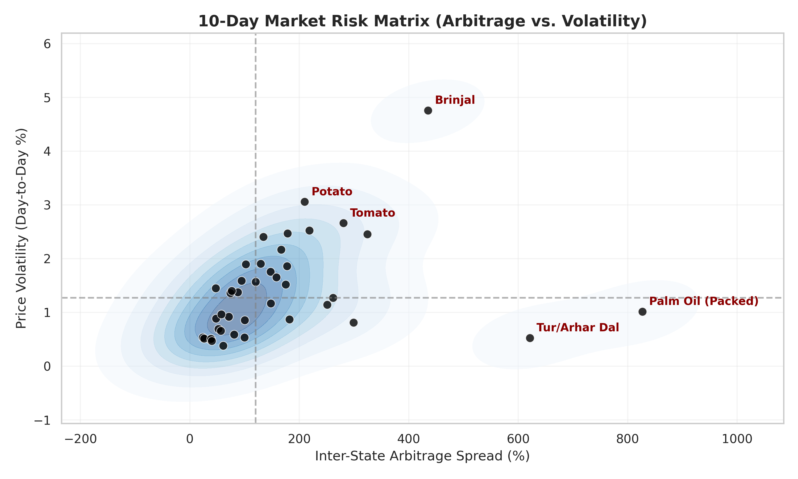

#  Agri-Price daily smart Dashboard
> **Status:** Operational | **Data Snapshot:** November 27, 2026

This automated engine tracks wholesale prices across India and uses Machine Learning to forecast short-term price momentum.

> **National Average Inflation:** 30-Day: +1.87% | 7-Day: -0.06% | 24-Hour: +0.02%

##  Price Momentum & Forecasts
| S.No | Commodity | 1-Month Trend | 1-Week Trend | Price Difference | Tomorrow (Forecast) |
|---|---|---|---|---|---|
| 1 | **Atta (Wheat)** | -1.86% | -0.01% | ₹37.09 | -₹0.36 |
| 2 | **Bajra (whole)** | -1.19% | -0.22% | ₹50.80 | -₹0.11 |
| 3 | **Banana** | -0.46% | -0.25% | ₹53.62 | -₹0.39 |
| 4 | **Besan** | +1.47% | +0.44% | ₹57.30 | -₹0.66 |
| 5 | **Black Pepper (whole)** | +0.81% | -0.23% | ₹26.33 | -₹0.09 |
| 6 | **Brinjal** | +4.36% | +2.44% | ₹163.96 | -₹1.44 |
| 7 | **Broken Rice** | +1.12% | -0.36% | ₹46.36 | -₹0.39 |
| 8 | **Butter (Pasteurised)** | +1.71% | -0.08% | ₹13.18 | -₹0.07 |
| 9 | **Coriander (whole)** | +3.58% | +0.45% | ₹49.09 | +₹0.51 |
| 10 | **Cummin Seed (whole)** | +1.21% | -0.11% | ₹46.09 | +₹0.24 |
| 11 | **Desi Ghee** | +2.62% | -0.08% | ₹443.69 | -₹1.28 |
| 12 | **Eggs** | +2.94% | -0.20% | ₹44.95 | -₹0.24 |
| 13 | **Garlic** | +2.13% | +0.45% | ₹57.29 | -₹0.32 |
| 14 | **Ginger** | -4.09% | -0.73% | ₹66.00 | -₹0.18 |
| 15 | **Gram Dal** | +2.75% | +0.26% | ₹35.75 | -₹0.41 |
| 16 | **Groundnut Oil (Packed)** | +3.76% | -0.62% | ₹223.25 | +₹0.02 |
| 17 | **Gur** | +1.69% | +0.21% | ₹58.75 | -₹0.35 |
| 18 | **Jowar (whole)** | +2.27% | +0.87% | ₹54.00 | -₹0.43 |
| 19 | **Maida (wheat)** | +1.20% | +1.00% | ₹41.09 | -₹0.49 |
| 20 | **Masoor Dal** | +0.21% | +0.07% | ₹49.73 | -₹0.43 |
| 21 | **Milk @** | +0.63% | -0.05% | ₹36.41 | +₹0.06 |
| 22 | **Moong Dal** | +0.76% | -0.05% | ₹26.26 | -₹0.12 |
| 23 | **Mustard Oil (Packed)** | +3.60% | +0.69% | ₹103.80 | -₹0.13 |
| 24 | **Onion** | +0.79% | -0.36% | ₹44.06 | -₹0.26 |
| 25 | **Palm Oil (Packed)** | +0.20% | -0.67% | ₹184.67 | -₹1.10 |
| 26 | **Potato** | -0.82% | +0.65% | ₹36.36 | -₹0.24 |
| 27 | **Ragi (whole)** | +2.63% | -2.49% | ₹73.00 | +₹0.42 |
| 28 | **Red Chillies (whole)** | +0.81% | -1.10% | ₹31.30 | +₹0.28 |
| 29 | **Rice** | +0.76% | +0.10% | ₹32.82 | -₹0.06 |
| 30 | **Salt Pack (Iodised)** | +2.01% | -0.63% | ₹21.07 | +₹0.03 |
| 31 | **Soya Oil (Packed)** | +5.74% | -0.28% | ₹160.64 | +₹1.11 |
| 32 | **Sugar** | +3.14% | -0.13% | ₹18.00 | +₹0.21 |
| 33 | **Suji (whole)** | +1.78% | -0.54% | ₹55.39 | -₹0.74 |
| 34 | **Sunflower Oil (Packed)** | -1.12% | +0.29% | ₹459.45 | -₹0.87 |
| 35 | **Tea Loose** | -0.38% | -1.12% | ₹415.09 | +₹0.25 |
| 36 | **Tomato** | -1.46% | +0.04% | ₹69.69 | -₹0.29 |
| 37 | **Tur/Arhar Dal** | +6.52% | +0.51% | ₹149.50 | -₹0.34 |
| 38 | **Turmeric (powder)** | +1.38% | -0.94% | ₹10.07 | +₹0.06 |
| 39 | **Urad Dal** | +1.31% | +0.26% | ₹47.75 | -₹0.52 |
| 40 | **Vanaspati (Packed)** | +3.75% | +0.25% | ₹79.81 | -₹1.21 |
| 41 | **Wheat** | +1.16% | +0.42% | ₹22.35 | -₹0.19 |

##  Visual Trends

### 30-Day Inflation Variance (National vs Extremes)
*The graph below represents the average cumulative inflation across India, compared against the specific State or Union Territory experiencing the highest and lowest price variations over the last 30 days.*

### 10-Day Market Risk Matrix (Arbitrage vs. Volatility)
**How to read this matrix:**

* **Bottom-Right Quadrant (Golden Zone):** High profit margins, stable prices.
* **Top-Right Quadrant (High Risk):** Huge profit margins, but prices change violently.
* **Top-Left Quadrant (Chaos Zone):** Low profit margins and highly unstable prices.
* **Bottom-Left Quadrant (Safe Zone):** Low profit margins, but very predictable staple prices.

<b>  Click to View: Daily State-by-State Highs & Lows</b>

| S.No | Commodity | Highest Price | Lowest Price | Today (Predicted) | Average |
|---|---|---|---|---|---|
| 1 | **Atta (Wheat)** | ₹71.50 (Andaman an) | ₹34.41 (Uttar Prad) | **₹42.79** | ₹43.36 |
| 2 | **Bajra (whole)** | ₹77.80 (Tripura) | ₹27.00 (Haryana) | **₹46.46** | ₹46.69 |
| 3 | **Banana** | ₹91.00 (Ladakh) | ₹37.38 (Madhya Pra) | **₹54.85** | ₹55.76 |
| 4 | **Besan** | ₹141.50 (Andaman an) | ₹84.20 (Tripura) | **₹102.60** | ₹103.56 |
| 5 | **Black Pepper (whole)** | ₹108.00 (DNH and DD) | ₹81.67 (Assam) | **₹91.87** | ₹91.99 |
| 6 | **Brinjal** | ₹195.00 (Andaman an) | ₹31.04 (Madhya Pra) | **₹49.09** | ₹51.69 |
| 7 | **Broken Rice** | ₹71.00 (Andaman an) | ₹24.64 (Bihar) | **₹40.10** | ₹40.79 |
| 8 | **Butter (Pasteurised)** | ₹71.00 (Andaman an) | ₹57.82 (Gujarat) | **₹62.29** | ₹62.27 |
| 9 | **Coriander (whole)** | ₹84.00 (Mizoram) | ₹34.91 (Gujarat) | **₹50.62** | ₹50.03 |
| 10 | **Cummin Seed (whole)** | ₹81.00 (Mizoram) | ₹34.91 (Gujarat) | **₹43.87** | ₹43.81 |
| 11 | **Desi Ghee** | ₹1099.00 (Goa) | ₹655.31 (Rajasthan) | **₹729.12** | ₹729.99 |
| 12 | **Eggs** | ₹119.50 (Andaman an) | ₹74.55 (Gujarat) | **₹88.17** | ₹88.42 |
| 13 | **Garlic** | ₹89.50 (Andaman an) | ₹32.21 (Bihar) | **₹49.74** | ₹50.34 |
| 14 | **Ginger** | ₹87.50 (Andaman an) | ₹21.50 (Uttarakhan) | **₹34.28** | ₹34.62 |
| 15 | **Gram Dal** | ₹124.00 (Andaman an) | ₹88.25 (Chhattisga) | **₹99.46** | ₹100.23 |
| 16 | **Groundnut Oil (Packed)** | ₹302.00 (Andaman an) | ₹78.75 (Sikkim) | **₹205.97** | ₹205.31 |
| 17 | **Gur** | ₹118.00 (Mizoram) | ₹59.25 (Chhattisga) | **₹71.67** | ₹72.21 |
| 18 | **Jowar (whole)** | ₹82.00 (Goa) | ₹28.00 (Arunachal ) | **₹48.65** | ₹49.42 |
| 19 | **Maida (wheat)** | ₹77.00 (Andaman an) | ₹35.91 (Bihar) | **₹45.05** | ₹45.90 |
| 20 | **Masoor Dal** | ₹130.00 (Ladakh) | ₹80.27 (Odisha) | **₹94.50** | ₹95.18 |
| 21 | **Milk @** | ₹82.00 (Mizoram) | ₹45.59 (Tamil Nadu) | **₹65.32** | ₹65.37 |
| 22 | **Moong Dal** | ₹135.89 (Mizoram) | ₹109.63 (Rajasthan) | **₹118.95** | ₹119.14 |
| 23 | **Mustard Oil (Packed)** | ₹270.00 (Andaman an) | ₹166.20 (Nagaland) | **₹221.39** | ₹222.47 |
| 24 | **Onion** | ₹90.00 (Andaman an) | ₹45.94 (Madhya Pra) | **₹57.51** | ₹57.89 |
| 25 | **Palm Oil (Packed)** | ₹206.00 (Andaman an) | ₹21.33 (Arunachal ) | **₹140.59** | ₹141.57 |
| 26 | **Potato** | ₹52.00 (Ladakh) | ₹15.64 (Assam) | **₹24.75** | ₹25.17 |
| 27 | **Ragi (whole)** | ₹100.00 (Mizoram) | ₹27.00 (Manipur) | **₹57.24** | ₹56.28 |
| 28 | **Red Chillies (whole)** | ₹56.00 (Goa) | ₹24.70 (Andhra Pra) | **₹33.58** | ₹33.36 |
| 29 | **Rice** | ₹69.38 (Karnataka) | ₹36.56 (Meghalaya) | **₹49.25** | ₹49.39 |
| 30 | **Salt Pack (Iodised)** | ₹32.67 (DNH and DD) | ₹11.60 (Tripura) | **₹24.07** | ₹23.96 |
| 31 | **Soya Oil (Packed)** | ₹220.00 (Ladakh) | ₹59.36 (Kerala) | **₹170.09** | ₹168.75 |
| 32 | **Sugar** | ₹73.50 (Andaman an) | ₹55.50 (Telangana) | **₹62.77** | ₹62.47 |
| 33 | **Suji (whole)** | ₹94.00 (Andaman an) | ₹38.61 (Bihar) | **₹51.08** | ₹52.12 |
| 34 | **Sunflower Oil (Packed)** | ₹640.00 (Ladakh) | ₹180.55 (Madhya Pra) | **₹207.61** | ₹210.30 |
| 35 | **Tea Loose** | ₹640.00 (Ladakh) | ₹224.91 (Gujarat) | **₹298.27** | ₹299.04 |
| 36 | **Tomato** | ₹96.00 (Mizoram) | ₹26.31 (Madhya Pra) | **₹43.39** | ₹44.06 |
| 37 | **Tur/Arhar Dal** | ₹171.00 (Andaman an) | ₹21.50 (Sikkim) | **₹137.17** | ₹137.53 |
| 38 | **Turmeric (powder)** | ₹24.75 (Mizoram) | ₹14.68 (Jharkhand) | **₹17.80** | ₹17.71 |
| 39 | **Urad Dal** | ₹157.50 (Andaman an) | ₹109.75 (Chhattisga) | **₹132.12** | ₹132.84 |
| 40 | **Vanaspati (Packed)** | ₹231.00 (Andaman an) | ₹151.19 (Andhra Pra) | **₹178.35** | ₹180.68 |
| 41 | **Wheat** | ₹51.00 (Manipur) | ₹28.65 (Uttar Prad) | **₹38.16** | ₹38.48 |

---
*Generated automatically by AgriPulse Engine on GitHub Actions.*
