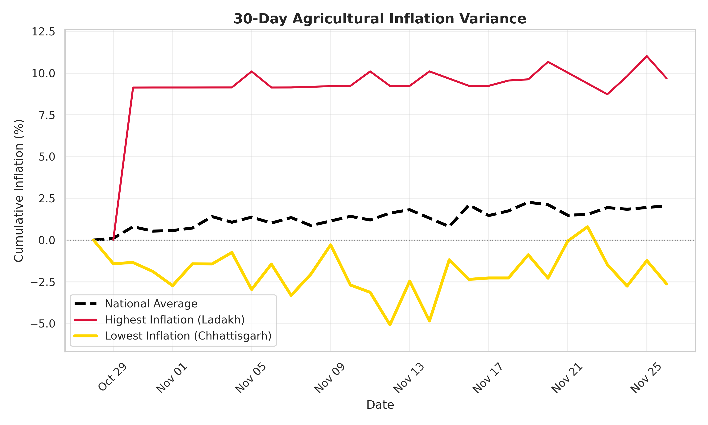

#  Agri-Price daily smart Dashboard
> **Status:** Operational | **Data Snapshot:** November 14, 2026

This automated engine tracks wholesale prices across India and uses Machine Learning to forecast short-term price momentum.

> **National Average Inflation:** 30-Day: +1.22% | 7-Day: -0.06% | 24-Hour: -0.05%

##  Price Momentum & Forecasts
| S.No | Commodity | 1-Month Trend | 1-Week Trend | Price Difference | Tomorrow (Forecast) |
|---|---|---|---|---|---|
| 1 | **Atta (Wheat)** | -0.79% | -2.03% | ₹33.29 | +₹0.51 |
| 2 | **Bajra (whole)** | +2.68% | -0.40% | ₹97.00 | -₹0.54 |
| 3 | **Banana** | -1.52% | -1.82% | ₹58.81 | +₹0.32 |
| 4 | **Besan** | +0.38% | -0.50% | ₹65.50 | +₹0.99 |
| 5 | **Black Pepper (whole)** | +0.69% | -0.85% | ₹26.80 | -₹0.20 |
| 6 | **Brinjal** | -1.89% | +0.65% | ₹163.50 | +₹0.31 |
| 7 | **Broken Rice** | +1.00% | -0.57% | ₹49.37 | +₹0.12 |
| 8 | **Butter (Pasteurised)** | +1.70% | -0.33% | ₹18.00 | -₹0.08 |
| 9 | **Coriander (whole)** | +2.63% | +1.20% | ₹57.56 | -₹0.32 |
| 10 | **Cummin Seed (whole)** | +2.74% | +0.92% | ₹45.79 | -₹0.52 |
| 11 | **Desi Ghee** | -0.39% | -0.50% | ₹197.19 | +₹10.42 |
| 12 | **Eggs** | +3.90% | +0.34% | ₹37.00 | -₹0.37 |
| 13 | **Garlic** | +0.00% | +0.23% | ₹58.84 | +₹0.44 |
| 14 | **Ginger** | -4.66% | +0.23% | ₹71.50 | -₹0.11 |
| 15 | **Gram Dal** | +2.16% | -0.37% | ₹47.80 | +₹0.87 |
| 16 | **Groundnut Oil (Packed)** | +4.28% | +2.14% | ₹235.00 | -₹1.59 |
| 17 | **Gur** | +1.58% | -0.57% | ₹62.83 | +₹0.13 |
| 18 | **Jowar (whole)** | +0.18% | -2.11% | ₹30.20 | +₹0.87 |
| 19 | **Maida (wheat)** | +1.21% | -1.19% | ₹43.44 | +₹0.03 |
| 20 | **Masoor Dal** | -0.61% | -1.12% | ₹44.19 | +₹0.30 |
| 21 | **Milk @** | -0.30% | -0.79% | ₹37.22 | +₹0.08 |
| 22 | **Moong Dal** | +0.54% | -0.83% | ₹28.66 | +₹0.75 |
| 23 | **Mustard Oil (Packed)** | +1.50% | -0.37% | ₹105.07 | +₹0.31 |
| 24 | **Onion** | -0.20% | -0.81% | ₹44.00 | +₹0.16 |
| 25 | **Palm Oil (Packed)** | +0.56% | -1.89% | ₹184.33 | +₹1.28 |
| 26 | **Potato** | -3.66% | -1.48% | ₹26.93 | +₹0.72 |
| 27 | **Ragi (whole)** | +5.76% | +0.72% | ₹71.37 | -₹0.34 |
| 28 | **Red Chillies (whole)** | +0.53% | -0.28% | ₹28.31 | +₹0.16 |
| 29 | **Rice** | +1.09% | +0.01% | ₹38.93 | +₹0.51 |
| 30 | **Salt Pack (Iodised)** | -0.17% | +0.33% | ₹20.40 | +₹0.14 |
| 31 | **Soya Oil (Packed)** | +6.22% | +1.92% | ₹147.50 | -₹3.33 |
| 32 | **Sugar** | +5.09% | +0.68% | ₹25.00 | -₹0.52 |
| 33 | **Suji (whole)** | -0.17% | -0.34% | ₹54.40 | +₹0.31 |
| 34 | **Sunflower Oil (Packed)** | +0.10% | -0.63% | ₹474.80 | -₹2.44 |
| 35 | **Tea Loose** | -0.20% | +0.71% | ₹433.80 | -₹0.80 |
| 36 | **Tomato** | -5.06% | -0.93% | ₹69.39 | -₹0.48 |
| 37 | **Tur/Arhar Dal** | +1.70% | -0.91% | ₹144.50 | +₹1.50 |
| 38 | **Turmeric (powder)** | +2.43% | -0.41% | ₹9.33 | -₹0.09 |
| 39 | **Urad Dal** | -0.00% | -0.64% | ₹49.17 | +₹0.65 |
| 40 | **Vanaspati (Packed)** | -0.77% | -0.44% | ₹72.46 | +₹1.15 |
| 41 | **Wheat** | +0.34% | -0.58% | ₹19.31 | +₹0.62 |

##  Visual Trends

### 30-Day Inflation Variance (National vs Extremes)
*The graph below represents the average cumulative inflation across India, compared against the specific State or Union Territory experiencing the highest and lowest price variations over the last 30 days.*

### 10-Day Market Risk Matrix (Arbitrage vs. Volatility)
**How to read this matrix:**

* **Bottom-Right Quadrant (Golden Zone):** High profit margins, stable prices.
* **Top-Right Quadrant (High Risk):** Huge profit margins, but prices change violently.
* **Top-Left Quadrant (Chaos Zone):** Low profit margins and highly unstable prices.
* **Bottom-Left Quadrant (Safe Zone):** Low profit margins, but very predictable staple prices.

<b>  Click to View: Daily State-by-State Highs & Lows</b>

| S.No | Commodity | Highest Price | Lowest Price | Today (Predicted) | Average |
|---|---|---|---|---|---|
| 1 | **Atta (Wheat)** | ₹67.50 (Andaman an) | ₹34.21 (Uttar Prad) | **₹43.39** | ₹42.72 |
| 2 | **Bajra (whole)** | ₹128.00 (Manipur) | ₹31.00 (Rajasthan) | **₹48.31** | ₹49.40 |
| 3 | **Banana** | ₹96.00 (Ladakh) | ₹37.19 (Madhya Pra) | **₹55.46** | ₹55.19 |
| 4 | **Besan** | ₹145.50 (Andaman an) | ₹80.00 (Manipur) | **₹102.74** | ₹101.49 |
| 5 | **Black Pepper (whole)** | ₹107.00 (Andaman an) | ₹80.20 (Chhattisga) | **₹91.40** | ₹91.81 |
| 6 | **Brinjal** | ₹183.50 (Andaman an) | ₹20.00 (Uttarakhan) | **₹49.24** | ₹49.64 |
| 7 | **Broken Rice** | ₹74.00 (Andaman an) | ₹24.63 (Bihar) | **₹40.52** | ₹40.67 |
| 8 | **Butter (Pasteurised)** | ₹74.00 (Andaman an) | ₹56.00 (Chhattisga) | **₹61.98** | ₹62.23 |
| 9 | **Coriander (whole)** | ₹92.00 (Mizoram) | ₹34.44 (Gujarat) | **₹49.85** | ₹50.34 |
| 10 | **Cummin Seed (whole)** | ₹80.29 (Mizoram) | ₹34.50 (Telangana) | **₹43.04** | ₹44.10 |
| 11 | **Desi Ghee** | ₹825.19 (Tamil Nadu) | ₹628.00 (Rajasthan) | **₹727.56** | ₹713.44 |
| 12 | **Eggs** | ₹111.00 (Andaman an) | ₹74.00 (Gujarat) | **₹87.91** | ₹88.69 |
| 13 | **Garlic** | ₹91.00 (Andaman an) | ₹32.16 (Bihar) | **₹49.45** | ₹49.07 |
| 14 | **Ginger** | ₹89.50 (Andaman an) | ₹18.00 (Uttarakhan) | **₹35.04** | ₹35.41 |
| 15 | **Gram Dal** | ₹130.00 (Ladakh) | ₹82.20 (Chhattisga) | **₹98.94** | ₹97.92 |
| 16 | **Groundnut Oil (Packed)** | ₹304.00 (Andaman an) | ₹69.00 (Ladakh) | **₹199.16** | ₹201.03 |
| 17 | **Gur** | ₹116.43 (Mizoram) | ₹53.60 (Chhattisga) | **₹71.59** | ₹71.45 |
| 18 | **Jowar (whole)** | ₹60.20 (Assam) | ₹30.00 (Arunachal ) | **₹48.84** | ₹47.59 |
| 19 | **Maida (wheat)** | ₹79.50 (Andaman an) | ₹36.06 (Bihar) | **₹45.47** | ₹45.65 |
| 20 | **Masoor Dal** | ₹123.80 (Tripura) | ₹79.61 (Odisha) | **₹94.21** | ₹93.96 |
| 21 | **Milk @** | ₹82.00 (Mizoram) | ₹44.78 (Tamil Nadu) | **₹64.59** | ₹64.51 |
| 22 | **Moong Dal** | ₹135.86 (Mizoram) | ₹107.20 (Chhattisga) | **₹119.01** | ₹118.01 |
| 23 | **Mustard Oil (Packed)** | ₹272.00 (Andaman an) | ₹166.93 (Nagaland) | **₹216.12** | ₹216.20 |
| 24 | **Onion** | ₹90.00 (Andaman an) | ₹46.00 (Rajasthan) | **₹57.35** | ₹57.24 |
| 25 | **Palm Oil (Packed)** | ₹206.00 (Andaman an) | ₹21.67 (Sikkim) | **₹141.10** | ₹139.12 |
| 26 | **Potato** | ₹41.43 (Mizoram) | ₹14.50 (West Benga) | **₹25.44** | ₹24.52 |
| 27 | **Ragi (whole)** | ₹100.00 (Mizoram) | ₹28.63 (Meghalaya) | **₹57.51** | ₹57.86 |
| 28 | **Red Chillies (whole)** | ₹53.00 (Ladakh) | ₹24.69 (Andhra Pra) | **₹33.28** | ₹33.16 |
| 29 | **Rice** | ₹75.68 (Karnataka) | ₹36.75 (Meghalaya) | **₹49.28** | ₹48.58 |
| 30 | **Salt Pack (Iodised)** | ₹32.00 (Ladakh) | ₹11.60 (Tripura) | **₹24.04** | ₹23.80 |
| 31 | **Soya Oil (Packed)** | ₹220.00 (Ladakh) | ₹72.50 (Andaman an) | **₹165.40** | ₹170.62 |
| 32 | **Sugar** | ₹80.00 (Ladakh) | ₹55.00 (Chandigarh) | **₹61.98** | ₹62.87 |
| 33 | **Suji (whole)** | ₹92.50 (Andaman an) | ₹38.10 (Himachal P) | **₹52.10** | ₹52.02 |
| 34 | **Sunflower Oil (Packed)** | ₹650.00 (Ladakh) | ₹175.20 (Chhattisga) | **₹207.92** | ₹212.49 |
| 35 | **Tea Loose** | ₹650.00 (Ladakh) | ₹216.20 (Chhattisga) | **₹300.92** | ₹302.10 |
| 36 | **Tomato** | ₹96.00 (Mizoram) | ₹26.61 (Karnataka) | **₹43.31** | ₹44.20 |
| 37 | **Tur/Arhar Dal** | ₹166.00 (Andaman an) | ₹21.50 (Sikkim) | **₹135.91** | ₹133.56 |
| 38 | **Turmeric (powder)** | ₹23.80 (Mizoram) | ₹14.47 (Tamil Nadu) | **₹17.57** | ₹17.79 |
| 39 | **Urad Dal** | ₹155.17 (Sikkim) | ₹106.00 (Chhattisga) | **₹131.82** | ₹130.84 |
| 40 | **Vanaspati (Packed)** | ₹225.50 (Andaman an) | ₹153.04 (Andhra Pra) | **₹179.19** | ₹177.93 |
| 41 | **Wheat** | ₹48.00 (Manipur) | ₹28.69 (Uttar Prad) | **₹38.63** | ₹37.80 |

---
*Generated automatically by AgriPulse Engine on GitHub Actions.*
